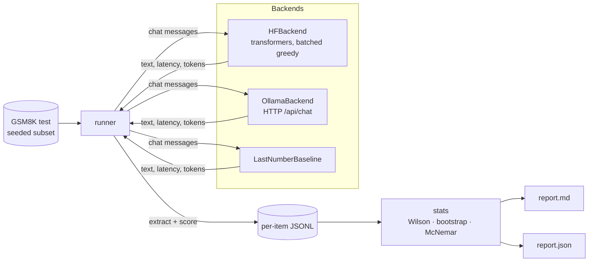

# llm-eval-harness

A small, dependency-light harness for evaluating LLMs the way you would in a real model-selection decision:
**exact-match accuracy with confidence intervals, latency, throughput, cost, and a paired A/B significance test** —
not just a single accuracy number.

The bundled task is a fixed, seeded 300-question subset of the [GSM8K](https://huggingface.co/datasets/openai/gsm8k)
test split (grade-school math word problems with a single numeric answer).

## Problem

"Model B scored 3 points higher" is meaningless without knowing the sample size, the variance, whether both models
were scored on the same items, and what the improvement costs in latency and GPU time. This harness makes those
numbers the default output so that a comparison between two models (or two checkpoints of the same model, as in
[qlora-finetune-demo](https://github.com/erickmacielsoto/qlora-finetune-demo)) is statistically honest.

## What it measures

| Metric | How |
|---|---|
| Accuracy | exact numeric match of the final answer (`The answer is: N`, `\boxed{N}`, `#### N`, else last number) |
| 95% CI | Wilson score interval |
| Parse failures | completions with no extractable number |
| Latency | per-item wall time (batched backends report batch time / batch size), p50 and p95 |
| Throughput | generated tokens / wall time |
| Cost | wall time × configurable USD per GPU-hour (default 0.20, an assumption, not a quote) and USD per 1k correct answers |
| A/B | paired bootstrap CI of the accuracy difference (10k resamples) and two-sided **exact McNemar** test on the discordant pairs |

## Architecture



* `tasks.py` – dataset sampling, prompt, answer extraction and normalisation.
* `backends.py` – a `Backend` protocol with Hugging Face, Ollama and baseline implementations.
* `runner.py` – runs a backend over the examples and stores one JSON line per item (plus a meta line).
* `stats.py` – Wilson interval, percentiles, exact McNemar, paired bootstrap (pure Python, no SciPy).
* `report.py` / `cli.py` – summaries, pairwise comparisons, Markdown and JSON output.

## Run it

```bash
pip install -e ".[hf,data,dev]"      # CUDA build of torch recommended

evalh run --model baseline:last-number          --n 300 --out results/baseline.jsonl
evalh run --model hf:Qwen/Qwen2.5-0.5B-Instruct  --n 300 --out results/qwen05.jsonl
evalh run --model hf:Qwen/Qwen2.5-1.5B-Instruct  --n 300 --out results/qwen15.jsonl
evalh run --model ollama:qwen2.5:1.5b            --n 300 --out results/ollama.jsonl   # needs `ollama serve`
                                                                                          # and `ollama pull qwen2.5:1.5b`

evalh report results/*.jsonl --markdown results/report.md --json results/report.json
```

`run_all.sh` reproduces the table below (`WITH_OLLAMA=1 bash run_all.sh` adds the Ollama model). Per-item outputs for every run are committed in `results/`.

## Results

Measured on one machine: Windows 11, RTX 3080 10 GB, Python 3.12, torch 2.14.1+cu126, transformers 5.22.2,
Ollama 0.32.1. Same 300 GSM8K test problems (seed 0), zero-shot, greedy, `max_new_tokens=384`. Hugging Face models
run in bf16 with batch size 16; the Ollama model runs one request at a time.

| Model | n | Accuracy | 95% CI (Wilson) | Parse fail | Hit token limit | p50 s/item | p95 s/item | Mean out tokens | Tok/s | Wall time s | GPU cost USD | USD / 1k correct |
|---|---:|---:|---|---:|---:|---:|---:|---:|---:|---:|---:|---:|
| `baseline:last-number` | 300 | 2.7% | 1.4% to 5.2% | 0 | n/a | 0.000 | 0.000 | 0 | 0 | 0.0 | 0.0000 | 0.0000 |
| `hf:Qwen/Qwen2.5-0.5B-Instruct` | 300 | 37.0% | 31.7% to 42.6% | 0 | 58 | 0.954 | 0.999 | 295 | 311 | 284.3 | 0.0158 | 0.1423 |
| `hf:Qwen/Qwen2.5-1.5B-Instruct` | 300 | 66.0% | 60.5% to 71.1% | 0 | 42 | 1.106 | 1.761 | 281 | 237 | 355.3 | 0.0197 | 0.0997 |
| `ollama:qwen2.5:1.5b` | 300 | 63.3% | 57.7% to 68.6% | 0 | 50 | 1.231 | 1.602 | 282 | 206 | 409.6 | 0.0228 | 0.1198 |

GPU cost assumes USD 0.20 per GPU-hour applied to wall time.

| A | B | Acc(A) - Acc(B) | 95% CI (paired bootstrap) | Only A correct | Only B correct | McNemar exact p | Significant (alpha=0.05) |
|---|---|---:|---|---:|---:|---:|---|
| `baseline:last-number` | `hf:Qwen/Qwen2.5-0.5B-Instruct` | -34.3 pp | -40.0 to -28.7 pp | 3 | 106 | 6.7e-28 | yes |
| `baseline:last-number` | `hf:Qwen/Qwen2.5-1.5B-Instruct` | -63.3 pp | -68.7 to -57.7 pp | 0 | 190 | 1.3e-57 | yes |
| `baseline:last-number` | `ollama:qwen2.5:1.5b` | -60.7 pp | -66.3 to -54.7 pp | 3 | 185 | 5.6e-51 | yes |
| `hf:Qwen/Qwen2.5-0.5B-Instruct` | `hf:Qwen/Qwen2.5-1.5B-Instruct` | -29.0 pp | -35.3 to -22.7 pp | 15 | 102 | 4.4e-17 | yes |
| `hf:Qwen/Qwen2.5-0.5B-Instruct` | `ollama:qwen2.5:1.5b` | -26.3 pp | -32.7 to -19.7 pp | 20 | 99 | 9.2e-14 | yes |
| `hf:Qwen/Qwen2.5-1.5B-Instruct` | `ollama:qwen2.5:1.5b` | +2.7 pp | -3.0 to +8.0 pp | 39 | 31 | 0.4 | no |

Run times: the two Hugging Face runs took 284 s and 355 s; the full `run_all.sh` (three models including downloads
and model loading) took 12 min 37 s. The Ollama run took 6 min 50 s; its first request (cold model load) took 48 s.

**Reading the table**

* **Scale matters, quantization barely does.** Qwen2.5-1.5B-Instruct beats the 0.5B model by 29 points
  (p ≈ 4e-17). The same 1.5B model served by Ollama in 4-bit (`Q4_K_M`) scores 2.7 points lower than bf16, but the
  difference is **not significant** (McNemar p = 0.40, CI −3.0 to +8.0 pp): 39 problems only bf16 solved vs. 31 only
  the 4-bit model solved.
* **Cost per correct answer favours the bigger model.** 1.5B is slower per item but so much more accurate that it
  costs less per 1,000 correct answers (USD 0.10 vs. 0.14 under the assumed GPU price).
* **The baseline is a sanity check**, not a competitor: answering with the last number in the question gets 2.7%,
  so the harness is not rewarding trivial heuristics.
* 14–19% of completions hit the 384-token limit and are cut off mid-reasoning (for the 1.5B model only 4 of those 42
  reached a final "The answer is" line, and 6 were scored correct via the last-number fallback), so the limit is a
  real, reported factor in the scores.
* Latency columns are comparable within a backend, not across them: HF numbers are amortised over a batch of 16,
  Ollama numbers are single-request.

## Limitations

* 300 items gives CIs of roughly ±5 points; small differences between similar models will not be significant.
* Greedy decoding, zero-shot, one prompt template. Scores are sensitive to the prompt and to `max_new_tokens`
  (384 here; completions that hit the limit usually fail to state a final answer).
* Latency for the Hugging Face backend is amortised over a batch of 16 and is not the latency a single user would
  see; it is useful for comparing models under identical conditions, not for SLOs.
* Cost is an estimate from wall time and an assumed hourly GPU price; it ignores power, idle time and memory.
* Exact match on the final number does not judge the reasoning; a right answer with wrong steps still counts.

## Tests

```bash
pytest -q
```

Unit tests cover answer extraction, Wilson/McNemar/bootstrap against known values, the runner, JSONL round trip
and the report, using fake backends (no GPU or downloads needed). CI runs ruff, mypy (strict) and pytest on
Python 3.10 and 3.12.

## License

MIT — see [LICENSE](LICENSE). GSM8K is © OpenAI, MIT-licensed; Qwen2.5 models are Apache-2.0.
